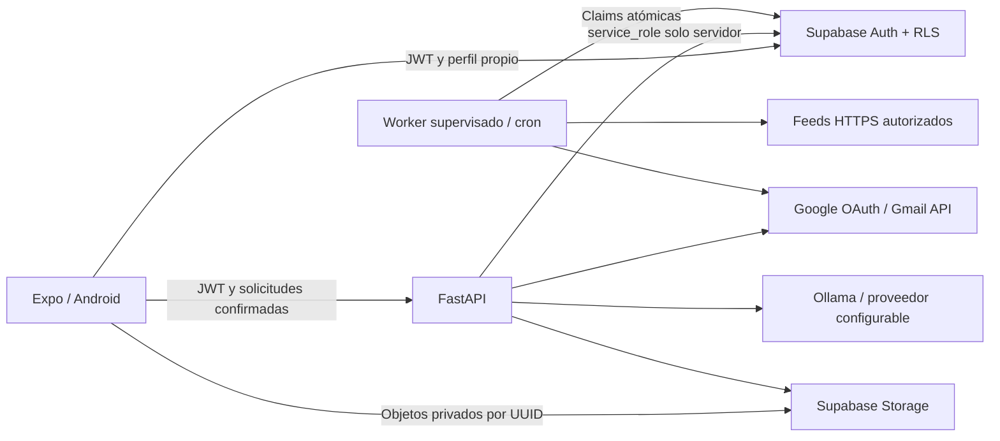

# Arquitectura

Trabajo YA separa la aplicación Android del procesamiento de servidor para que
las tareas no dependan del teléfono. Supabase es la fuente de identidad, datos y
documentos privados; FastAPI aplica las reglas de negocio y coordina proveedores.

## Módulos

`mobile/src/screens` reúne cuatro pantallas y autenticación. `components` y
`theme` contienen estilos y componentes reutilizables. `services` separa Supabase,
backend y acceso a datos; `state/demo` conserva fixtures explícitos sin operaciones
externas. Las variables `EXPO_PUBLIC_*` son públicas. La sesión se guarda mediante
SecureStore en Android. El registro y el ingreso solicitan un Email OTP de
Supabase; la sesión solo se acepta después de verificar el código. El tema
claro/oscuro/dispositivo se conserva localmente y el modo dispositivo sigue los
cambios del sistema. Ver [configuración de Auth](AUTH_SETUP.md).

`backend/app/main.py` expone rutas y valida modelos. `auth.py` verifica el JWT
consultando Supabase Auth; `db.py` encapsula REST, Storage y RPC. Los servicios
`ai`, `resumes`, `schedule`, `feeds`, `mail` y `account` separan responsabilidades.
`worker.py` ejecuta tareas periódicas fuera del ciclo de vida de la aplicación.

`supabase/migrations` define tablas, políticas RLS, privilegios por columna,
buckets privados y funciones de coordinación. `private` conserva ciphertext de
OAuth y no forma parte de los schemas de API. El contrato de campos y RPC está
en [CONTRACT.md](../supabase/CONTRACT.md).

## Flujos

1. El usuario verifica un código enviado a su correo, crea o recupera su cuenta
   sin contraseña y edita su perfil bajo RLS. Sube cada CV a una ruta
   nueva de Storage que empieza con su UUID y registra la versión. FastAPI descarga
   y extrae texto; no atribuye datos nuevos al perfil sin revisión del usuario.
2. El chat produce una propuesta estructurada validada. El usuario la confirma y
   FastAPI guarda una búsqueda con ciudades, roles, zona IANA y próxima ejecución.
   El modo solicitado no crea por sí solo consentimiento de envío.
3. El worker reclama búsquedas vencidas con `FOR UPDATE SKIP LOCKED`, token y
   lease. Consulta únicamente integraciones autorizadas, filtra coincidencias y
   deduplica ofertas por usuario. Prepara borradores y registra el resultado real.
4. Envío manual: el usuario aprueba una postulación concreta. Envío automático:
   debe existir un consentimiento vigente que limite búsqueda/CV/remitente/fuentes.
   Se concede una vez por configuración, con vencimiento máximo de 90 días; las
   tareas diarias no necesitan una aprobación individual mientras siga vigente.
   El permiso de recordatorios se acepta por separado al renovar la autorización.
   Ambos caminos reservan un único intento mediante RPC antes de llamar al correo,
   dentro de un cupo global de 10 intentos por usuario y día.
5. Solo la confirmación con identificador del proveedor permite guardar `sent`.
   Si hay incertidumbre tras un timeout, no se reenvía automáticamente. La interfaz
   muestra pendiente/error sin inventar confirmaciones ni respuestas.
6. Con recordatorios autorizados, una ejecución posterior puede crear una nueva
   postulación vinculada a la original. Exige 72 horas desde el último envío
   confirmado al destinatario y una vacante aún compatible, vigente y recuperada
   de una fuente autorizada durante esa ejecución. Se conservan mensaje, CV,
   fecha y recibo de cada envío por separado.

## Planificación y concurrencia

El backend calcula el siguiente instante UTC a partir de hora local, frecuencia,
días ISO y zona IANA. Las búsquedas diarias y semanales son independientes. El
worker funciona en un proceso permanente o como cron con `--once`; usar cualquiera
requiere mantener el servidor disponible.

La base serializa claims y reservas de envío. Los workers comprueban el token y
vencimiento antes de efectos; un worker antiguo no puede cerrar una lease
recuperada por otro. Al recuperar una tarea, el intento vencido queda en error y
no se declara completado. Si el usuario cambia el horario durante un run, la
finalización conserva el próximo instante recalculado para la configuración nueva.

Las reservas cuentan para el límite global de 10 intentos por usuario y día
calendario, incluso si fallan. Comparten ese cupo los envíos manuales, automáticos
y recordatorios de todas las búsquedas y cuentas conectadas. Se calcula con la
zona estable `profiles.sending_timezone`, inicialmente
`America/Argentina/Buenos_Aires`; las zonas de las búsquedas solo controlan su
horario y no reinician el cupo. La base serializa la reserva de cada usuario para
evitar que workers concurrentes superen el límite.

El consentimiento puede revocarse; renovarlo reemplaza el permiso anterior de
forma atómica. Los permisos V2 conservan los envíos iniciales y no conceden
recordatorios. Un permiso V3 con `repeat_enabled=true` fija un intervalo mínimo
de 3 días. El backend permite `repeat_every_days: 0 | 3` y exige el texto de
aceptación correspondiente. Pausar la búsqueda bloquea reservas futuras.

En cada ejecución las vacantes nuevas y los borradores sin intentos tienen
prioridad sobre los recordatorios. Estos crean una fila nueva con
`parent_application_id` y `delivery_sequence`, dejando el historial confirmado
sin cambios. La base normaliza el correo del destinatario y aplica 72 horas de
espera desde su último envío confirmado a través de todas las búsquedas. Una
respuesta registrada, una reserva pendiente o un resultado incierto a ese correo
bloquean nuevas reiteraciones automáticas. Un operador debe conciliar los
resultados inciertos con el proveedor antes de decidir una recuperación.
El endpoint `stop-followups` permite al usuario detener recordatorios a ese
destinatario entre todas sus búsquedas; las reservas futuras consultan el bloqueo.
Una reserva ya creada no se cancela retrospectivamente.

La ejecución guarda la observación actual de la oferta: fuente, destinatario
verificado, estado vigente y coincidencia con la configuración reclamada. Las
RPC validan esa observación junto con la lease; un registro histórico sin una
consulta actual no habilita un recordatorio. Si no hay vacantes aptas ni
recordatorios elegibles, no se envía. Las leases no convierten una API externa
en una transacción distribuida; el recibo y la reserva son evidencia complementaria.

## Extensión y despliegue

API y worker comparten configuración de servidor, pero pueden desplegarse y
escalarse por separado. Supabase permite varios usuarios y workers con aislamiento
por cuenta. Para un producto publicado agregar gateway con límites por usuario,
observabilidad sin contenido personal, backups, rotación de secretos y política
de retención. Mantener tareas idempotentes y contratos de feeds con límites.

Próximos adaptadores: Microsoft OAuth, OCR, fuentes laborales contratadas,
conciliación de envíos y detección autorizada de respuestas. El matching actual
compara ciudad y texto del puesto; no publica puntajes de IA que no se hayan calculado.
